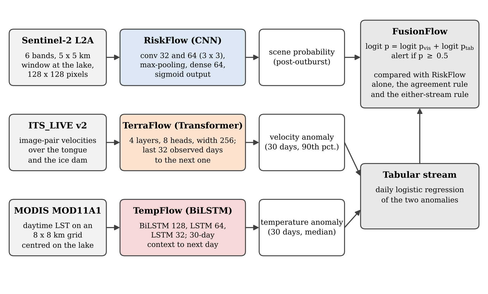

<div align="center">

# IceWatch

**A multimodal deep-learning framework for monitoring glacial lake outburst floods, evaluated at Shisper Glacier, Karakoram**

[-b31b1b)](#citation)
[](https://www.python.org/)
[](LICENSE)

</div>

IceWatch combines a convolutional classifier of Sentinel-2 scenes with forecasts of glacier velocity and land-surface temperature and a probabilistic fusion stage. It is tested at the ice-dammed lake of Shisper Glacier (Hunza valley, Karakoram, Pakistan), which drained four times between 2019 and 2022. All data are taken over the lake and its ice dam, and scenes are labelled from a published outburst chronology (Lovell and Muhammad, 2025).

| Module | Model | Input | Output |
|---|---|---|---|
| **RiskFlow** | CNN (two convolution blocks, dense 64) | Sentinel-2 L2A, 6 bands, 5 x 5 km window at the lake, 128 x 128 px | probability that a scene shows the lake after an outburst |
| **TerraFlow** | Transformer encoder (4 layers, 8 heads, width 256) | previous 32 observed days of ITS_LIVE velocity of a pixel | maximum speed on the next observed day |
| **TempFlow** | stacked BiLSTM (128, 64, 32) | 30-day context of MODIS daytime land-surface temperature | temperature 1 to 4 days ahead |
| **FusionFlow** | log-odds pooling | RiskFlow and a daily logistic regression of velocity and temperature anomalies | fused probability, alert at 0.5 |



## Main results

- Trained on the years up to 2021 and tested on 2022 to 2025, RiskFlow detected both post-outburst scenes of 2022 with 2 false alarms in 102 other scenes. With each year held out in turn, it detected 4 of 7 post-outburst scenes with no false alarm in 151 others, whereas a water-index rule detected all 7 but raised 26 false alarms.
- A RiskFlow model trained on 103 other ice-dammed lakes did not transfer to Shisper.
- TerraFlow forecast the next observed velocity with a mean absolute error of 28.6 m/yr, against 40.7 m/yr for persistence.
- TempFlow was the most accurate forecast two days ahead at the lake (4.83 K, against 4.95 K for persistence and 5.10 K for climatology).
- Neither the agreement rule nor the fusion improved on RiskFlow. IceWatch can confirm drainage from the next clear scene; anticipating outbursts will require observations of lake filling.

## Repository

| Notebook | Purpose | Runtime |
|---|---|---|
| [`01_sentinel2_export`](notebooks/01_sentinel2_export.ipynb) | Sentinel-2 L2A scenes of the lake on the GLOFNet archive dates; maps the lake centre | CPU |
| [`02_sentinel2_screening`](notebooks/02_sentinel2_screening.ipynb) | cloud screening of every Sentinel-2 acquisition, December 2018 to March 2025 | CPU |
| [`03_sentinel2_screening_2025_2026`](notebooks/03_sentinel2_screening_2025_2026.ipynb) | the same screening after the archive, with open water at the lake | CPU |
| [`04_modis_lst`](notebooks/04_modis_lst.ipynb) | MODIS MOD11A1 daytime LST on an 8 x 8 grid at the lake | CPU |
| [`05_itslive_velocity`](notebooks/05_itslive_velocity.ipynb) | ITS_LIVE v2 velocities over the tongue and the ice dam | CPU |
| [`10_riskflow`](notebooks/10_riskflow.ipynb) | RiskFlow: main split and leave-one-year-out, five seeds, water-index rule | GPU |
| [`11_multisite_export`](notebooks/11_multisite_export.ipynb) | Sentinel-2 scenes of 120 other ice-dammed lakes from the global GLOF database | CPU |
| [`12_multisite_riskflow`](notebooks/12_multisite_riskflow.ipynb) | RiskFlow trained on the other lakes and tested at Shisper | GPU |
| [`20_terraflow`](notebooks/20_terraflow.ipynb) | TerraFlow: next-observation velocity forecasts | GPU |
| [`30_tempflow`](notebooks/30_tempflow.ipynb) | TempFlow: LST forecasts 1 to 4 days ahead, at the lake grid or the original points | GPU |
| [`40_fusionflow`](notebooks/40_fusionflow.ipynb) | velocity and temperature anomalies, tabular stream, FusionFlow and the decision rules | CPU |

`data/` holds the small inputs: the archive dates (`s2_dates.txt`), the lakes and outbursts selected from version 4.2 of the global GLOF database (`glofdb_*.csv`, Lützow et al., 2023) and the GLOFNet LST at the original points (`lst_original_points.csv.gz`). `scripts/make_figures.py` draws Figs. 2 to 5 and 9 to 11 of the paper from the notebook outputs; Figs. 6 to 8 are written by notebooks 20 and 30.

## Data

The data used in the paper are available at **[Google Drive](ADD-LINK-HERE)**:

| Folder | Content | Made by |
|---|---|---|
| `Shisper_lake_S2` | 158 Sentinel-2 L2A scenes (GeoTIFF, 6 bands, 10 m) and `lake_location.json` | notebook 01 |
| `Shisper_LST_MODIS` | `lst_lake.csv`, daytime LST of 64 points, 24 February 2000 to 1 January 2023 | notebook 04 |
| `Shisper_velocity_ITSLIVE` | `shisper_velocity.csv.gz`, 49.4 million image-pair velocities | notebook 05 |
| `RiskFlow_multisite_scenes` | one `.npz` of scenes per lake for the transfer test | notebook 11 |

All of them can be rebuilt from public archives with the notebooks: Sentinel-2 and MODIS from the [Microsoft Planetary Computer](https://planetarycomputer.microsoft.com), velocities from the [ITS_LIVE](https://doi.org/10.5067/JQ6337239C96) version 2 datacubes. The GLOFNet dataset (Fatima et al., 2025) is available [here](https://drive.google.com/drive/folders/191x2uwFRzgd2CMfqpqdVw0UrT5YZYjHN).

## Running

The notebooks are written for Google Colab and read and write folders under `DRIVE` (default `/content/drive/MyDrive`), set in the first code cell.

1. Put the data folders in `DRIVE`, or create them with notebooks 01 to 05 and 11.
2. Run `10_riskflow`, `12_multisite_riskflow`, `20_terraflow` and `30_tempflow` (with `SITE = 'lake'`, and with `SITE = 'original_points'` for the comparison) on a GPU runtime.
3. Run `40_fusionflow`.
4. `python scripts/make_figures.py <DRIVE> figures`

Requirements are listed in `requirements.txt`; Colab provides most of them.

## Citation

```bibtex
@article{fatima2026icewatch,
  author  = {Fatima, Zuha and Sohaib, Muhammad Anser and Talha, Muhammad and
             Kanwal, Ayesha and Sultana, Sidra and Perwaiz, Nazia},
  title   = {{IceWatch}: a multimodal deep-learning framework for monitoring glacial
             lake outburst floods, evaluated at {Shisper} {Glacier}, {Karakoram}},
  journal = {Natural Hazards and Earth System Sciences},
  note    = {Under review},
  year    = {2026}
}

@inproceedings{fatima2025glofnet,
  author    = {Fatima, Zuha and Sohaib, Muhammad Anser and Talha, Muhammad and
               Sultana, Sidra and Kanwal, Ayesha and Perwaiz, Nazia},
  title     = {{GLOFNet}: a multimodal dataset for {GLOF} monitoring and prediction},
  booktitle = {Proc. Int. Conf. on Digital Futures and Transformative Technologies (ICoDT2)},
  pages     = {1--8},
  doi       = {10.1109/ICoDT269104.2025.11360730},
  year      = {2025}
}
```

## References

- Lovell, H. and Muhammad, S.: Multiple phases of ice-dammed lake formation and drainage associated with a surge of Shisper Glacier, western Karakoram, J. Glaciol., 71, e10, https://doi.org/10.1017/jog.2024.80, 2025.
- Lützow, N., Veh, G. and Korup, O.: A global database of historic glacier lake outburst floods, Earth Syst. Sci. Data, 15, 2983-3000, https://doi.org/10.5194/essd-15-2983-2023, 2023.
- Gardner, A. S. et al.: MEaSUREs ITS_LIVE Regional Glacier and Ice Sheet Surface Velocities, Version 2, NASA NSIDC DAAC, https://doi.org/10.5067/JQ6337239C96, 2025.
- Wan, Z., Hook, S. and Hulley, G.: MODIS/Terra Land Surface Temperature/Emissivity Daily L3 Global 1km SIN Grid V061, NASA LP DAAC, https://doi.org/10.5067/MODIS/MOD11A1.061, 2021.

## Authors

Zuha Fatima, Muhammad Anser Sohaib, Muhammad Talha, Ayesha Kanwal, Sidra Sultana and **Nazia Perwaiz** (corresponding, nazia.perwaiz@seecs.edu.pk)

School of Electrical Engineering and Computer Science (SEECS), National University of Sciences and Technology (NUST), Islamabad, Pakistan

## License

Code: MIT License, see [LICENSE](LICENSE). Sentinel-2 data: European Union, Copernicus programme. ITS_LIVE and MODIS products: NASA. Outburst records: global GLOF database v4.2 (Lützow et al., 2023).
